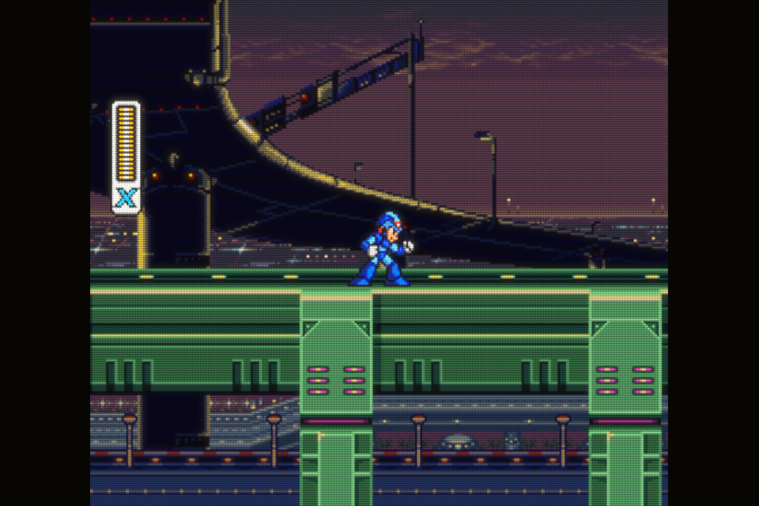
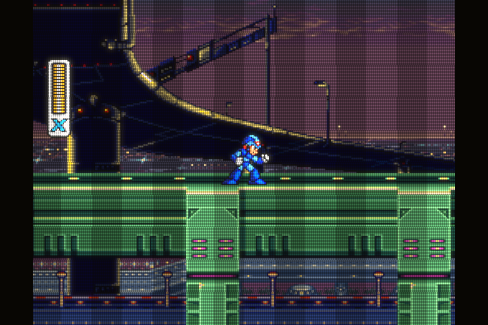
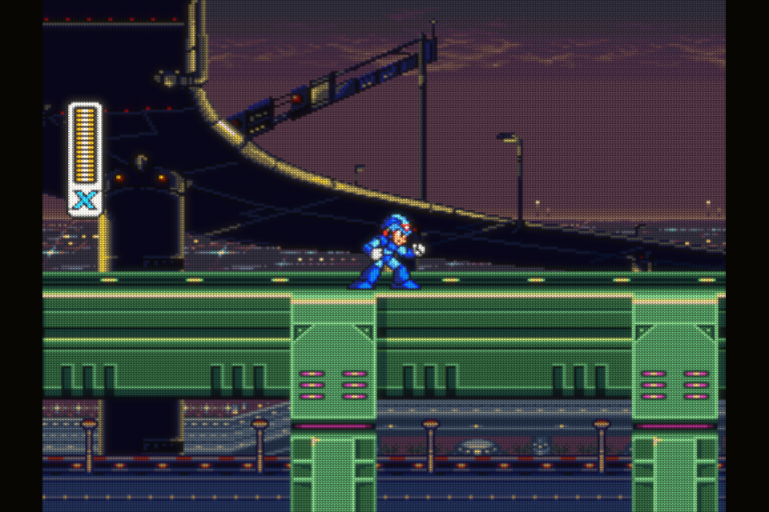
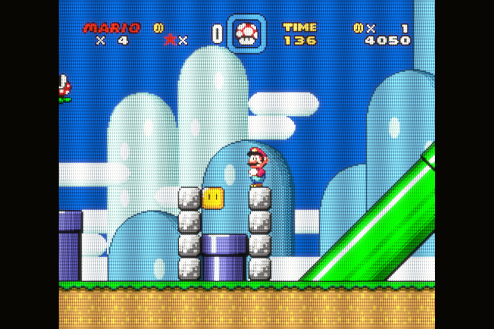
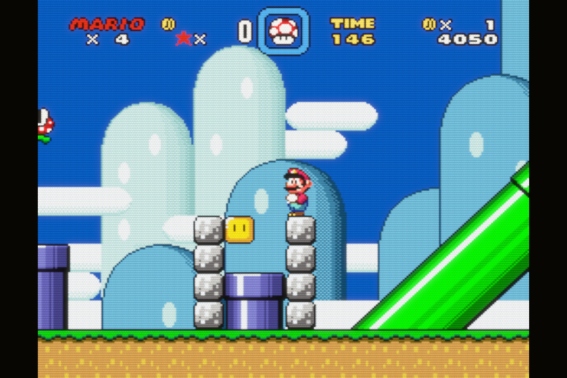
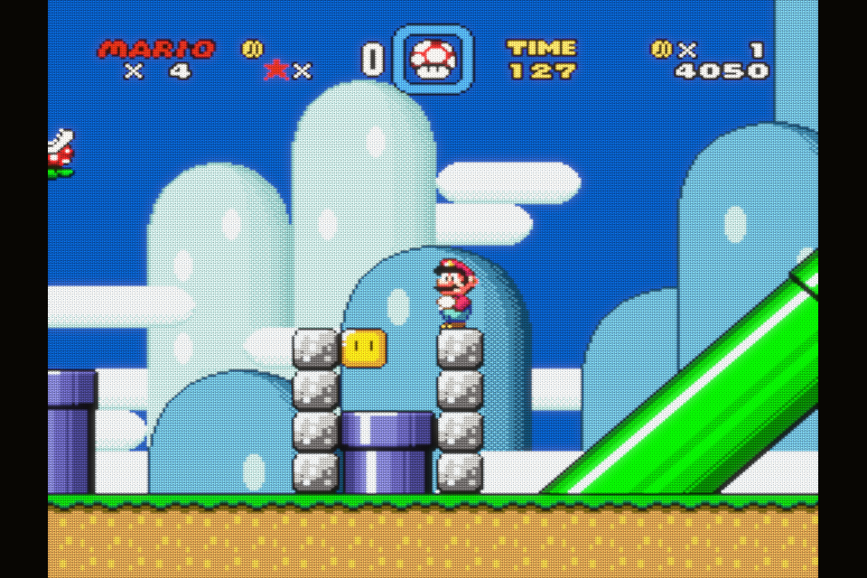
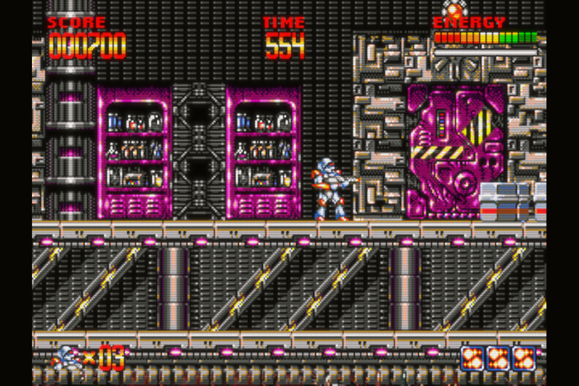
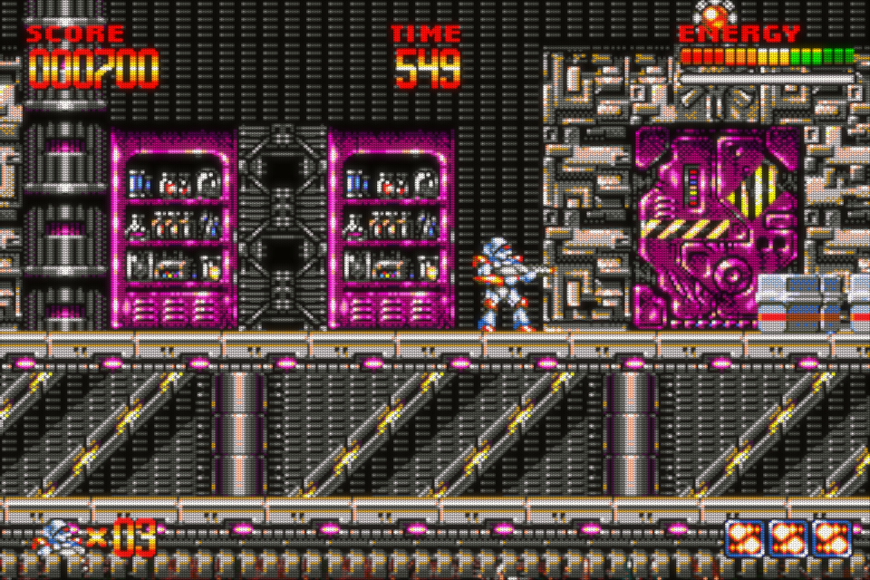
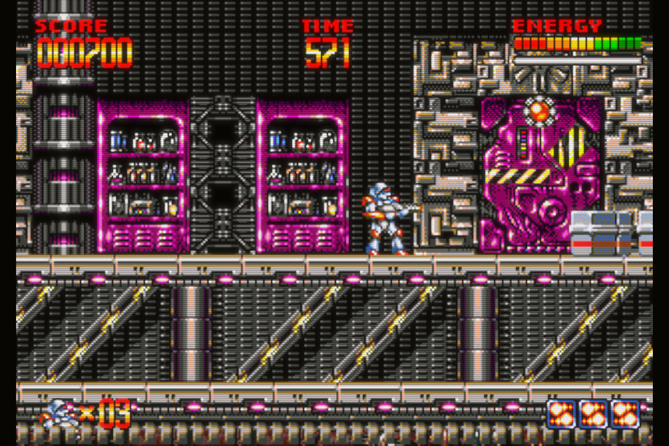

> **Author's Note:** The recommendations and technical choices presented here are my own. Because English is not my native language, I used Gemini to translate and format my personal notes, as well as to assist with some of the mathematical calculations.

# Installation Preparation for a Konkr Pocket Advance

## RetroArch Scaling for LCD Systems

Because grid shaders often can't deal decently with non integer scaling, we use integer scaling for every handheld system. Platforms up to GBA are 4x, NDS is 3x and PSP is 2x. Just set the following and you are done :
- **Integer Scale:** `On`
- **Integer Scale Axis:** `Y`
- **Aspect Ratio:** `Core Provided`

**The NDS exception:**

The exception is NDS. Displaying both screen on the KPA make the screens so tiny that it is unplayable. So better display on screen large and a small vignete for the second one. Unfortunately, the `Melon DS DS` core options to balance both screens are very limited and lead to non intsger scaling on both screens.

NDS 256x192 screens display at 3x but there is wasted real estate if you display only that. So the preferred layout is to display one main large screen at 3x on the left, and a thumbnail of the second screen on the right, in the remaining space. I like to spare a small black separation line between both displays. But `Melon DS DS` can't do any of this that so I had to develop a custom shader that takes a top/bottom or bottom/top layout from the core, splits it into two seperate screens and displays them it as I want. The shader preset adds a `lcd1x` grid because that's the whole point. There is one version with NDS corrected collors, and one with raw colors from the core.

To make this work, we need an NDS core override for scaling and set the viewport as such :

- **Integer Scale:** `OFF`
- **Aspect Ratio:** `Custom`
- **Custom Aspect Ratio (Width):** `960` (Justification: fill the whole width to maximize the thumbnail size)
- **Custom Aspect Ratio (Height):** `576` (Justification: 3x the NDS vertical resolution of 192)

> More in the [shaders dedicated page](shaders.md).

## RetroArch CRT Scaling Doctrine

The Konkr Pocket Advance (KPA) features a 3:2 aspect ratio screen (960 × 640). While ideal for the Game Boy Advance, playing standard 4:3 legacy consoles with default settings results in massive black borders (pillarboxing).

To maximize screen real estate, the following configurations rely on a dual approach:
1. **Vertical Overscan Cropping:** Surgically cutting unused top and bottom margins to enlarge the image, while strictly ensuring all in-game UI elements and HUDs remain fully visible and comfortable.
2. **Horizontal Stretching:** Expanding the Pixel Aspect Ratio (PAR) aiming around ~4.5% (and strictly capped below the commonly accepted human perception threshold of 5%) to reduce black bars without noticeable geometric distortion. Fixing viewports in this manner also abstracts away the multi-resolution switching chaos of certain consoles, guaranteeing high display consistency.

**The Historical Stretch Exception:**
For platforms featuring narrower native resolutions that already suffered from severe horizontal stretching on original 4:3 CRT televisions (such as the NES and PC Engine in 16:15 or the SNES in 8:7), we deliberately exceed the 5% limit on the PAR 1:1. By targeting the midpoint between the historical 4:3 Display Aspect Ratio (DAR) and the mathematical 1:1 Pixel Aspect Ratio (+8.33% on SNES and up to +12.50% on NES/PCE), we reduce the original geometric distortion while flattering visual memory.

|  |  |  |
| :---: | :---: | :---: |
|  |  |  |
| PAR 1:2... small | DAR 4:3... too much stretch | Custom tradeoff |

<em>Examples of screen ratios for SNES</em>

### Quick Reference Summary

For all systems below, the following baseline settings are **strictly mandatory** to ensure the auto-centering math works correctly (leaving cores on their default configurations):
- **Integer Scale:** `OFF`
- **Aspect Ratio:** `Custom`
- **Custom Aspect Ratio (X Position):** `0`
- **Custom Aspect Ratio (Y Position):** `0`
- **Crop Overscan:** `OFF`
- **Custom Aspect Ratio (? Position):** See Viewport column below.

| Platform (Core) | Core Output Resolution (DAR) | Native Tolerance (per side) | Remaining Native Displayed Resolution | Viewport: Conservative Even Rounds (`W × H`) | Horizontal Stretch Applied to PAR |
| :--- | :--- | :--- | :--- | :--- | :--- |
| **Atari 2600** (`Stella`) | `160 × 210 (4:3)` | **7 px** | `160 × 196` | **956 × 686** | **+4.52%** |
| **NES** (`Mesen`) | `256 × 240 (16:15)` | **12 px** | `256 × 216` | **852 × 710** | **+12.50%** |
| **Master System** (`Genesis Plus GX`) | `256 × 192 (4:3)` | **0 px** | `256 × 192` | **892 × 640** | **+4.53%** |
| **PC Engine** (`Beetle PCE Fast`) | `256 × 240 (16:15)` | **8 px** | `256 × 224` | **822 × 686** | **+12.34%** |
| **Super Nintendo** (`Snes9x`) | `256 × 224 (8:7)` | **5.33 px** | `256 × 213.3` | **832 × 672** | **+8.33%** |
| **Mega Drive** (`Genesis Plus GX`) | `320 × 224 (10:7)` | **0 px** | `320 × 224` | **960 × 640** | **+5.00%** |
| **Sega Saturn** (`YabaSanshiro`) | `320 × 240 (4:3)` | **2 px** | `320 × 236` | **906 × 650** | **+4.54%** |
| **PlayStation 1** (`SwanStation`) | `320 × 240 (4:3)` | **2 px** | `320 × 236` | **906 × 650** | **+4.54%** |
| **Nintendo 64** (`Mupen64Plus-Next`) | `320 × 240 (4:3)` | **6 px** | `320 × 228` | **940 × 674** | **+4.60%** |
| **Dreamcast** (`Flycast`) | `640 × 480 (4:3)` | **0 px** | `640 × 480` | **892 × 640** | **+4.53%** |
| **Arcade** (`FBNeo`) | `Var. × 224 (4:3)` | **0 px** | `Var. × 224` | **892 × 640** | **+4.53%** |
| **Neo Geo** (`FBNeo`) | `320 × 224 (4:3)` | **0 px** | `320 × 224` | **892 × 640** | **+4.53%** |
| **Amiga** (`PUAE`) | `320 × 256 (4:3)` | **0 px** | `320 × 256` | **892 × 640** | **+4.53%** |

|  |  |  |
| :---: | :---: | :---: |
| DAR 4:3... narrowish shapes | Custom tradeoff with a 5% stretch | PAR 10:7... balanced shapes with small black bars |

<em>Perfect fit with only strech for Mega Drive</em>

### Real-World Display Metrics (Surface vs. Perceived Size)

Because we are using a 3:2 3.5-inch screen (960 × 640) to primarily display 4:3 content, measuring the image solely by its physical displayed diagonal is mathematically misleading. By pushing vertical overscan margins outside the physical screen frame, we enlarge the rendering window beyond hardware limits.

This unified table distinguishes two complementary realities:
1. **Displayed Surface:** What actually lights up on the physical KPA screen.
2. **Underlying Canvas:** The full size of the rendered game window (including cropped off-screen lines). By converting this underlying surface into an **Equivalent 4:3 Diagonal**, we measure the true optical gain of this approach: *the actual sprite size as perceived by the eye* compared to a standard 4:3 handheld.

| System(s) | Displayed AR | Displayed Diagonal | Screen Surface | Underlying AR (crop incl.) & PAR Stretch | Underlying Diagonal | Equivalent 4:3 Diagonal |
| :--- | :--- | :--- | :--- | :--- | :--- | :--- |
| **Mega Drive** | 1.50 (3:2) | **3.50"** | 100.0% | 1.50 (3:2) + 5.00% stretch | 3.50" | **3.43"** |
| **Atari 2600** | 1.49 (~3:2) | **3.49"** | 99.6% | 1.39 (~7:5) + 4.52% stretch | 3.57" | **3.55"** |
| **Nintendo 64** | 1.47 (~47:32) | **3.45"** | 97.9% | 1.39 (~7:5) + 4.60% stretch | 3.51" | **3.49"** |
| **PS1 & Saturn** | 1.42 (~7:5) | **3.36"** | 94.4% | 1.39 (~7:5) + 4.54% stretch | 3.38" | **3.36"** |
| **SMS / DC / Arcade / Neo Geo / Amiga** | 1.39 (~7:5) | **3.33"** | 92.9% | 1.39 (~7:5) + 4.53% stretch | 3.33" | **3.31"** |
| **NES** | 1.33 (4:3) | **3.23"** | 88.8% | 1.20 (6:5) + 12.50% stretch | 3.36" | **3.41"** |
| **Super Nintendo** | 1.30 (13:10) | **3.18"** | 86.7% | 1.24 (~11:9) + 8.33% stretch | 3.24" | **3.27"** |
| **PC Engine** | 1.28 (~9:7) | **3.16"** | 85.6% | 1.20 (6:5) + 12.34% stretch | 3.25" | **3.29"** |

**The Verdict:**
Even though the Konkr Pocket Advance is a 3:2 device, this scaling doctrine effectively neutralizes the screen ratio penalty. By utilizing extra screen width to safely zoom and crop unneeded vertical margins, systems like the Atari 2600, N64, or NES render 3D models and sprites at a size equivalent to a **3.41 to 3.55-inch 4:3 screen**. Even systems with zero vertical crop (3.31") or narrower ratios like the PC Engine (3.29") and Super Nintendo (3.27") retain a perceived size very close to a native 3.5-inch 4:3 display.

## Shaders for the KPA

### CRT Shaders

The KPA doesn't have a high resolution by modern shader standards, and its processor isn't powerful enough to handle complex multi-pass shaders. A modest resolution isn't a big deal when using integer scaling, but unfortunately, as shown above, many systems require non-integer scaling. Therefore, one needs to find and carefully set up shaders that are known to be robust to fractional scaling:

- I tried my best with `hyllian`, but I failed to find decent parameters that deliver a nice look with zero (or very little) moiré and artifacts.
- I got good results with `crt-guest-advanced-fast` despite the KPA's 640p vertical resolution. However, even in its `fast` variant, `guest` is too heavy—even when restricted to older, easy-to-emulate platforms, it drains too much battery to justify the visual upgrade.

My non-negotiable prerequisite is to do things properly, which means:

- **Scanlines** must align with the game's native pixel rows, not the device's physical screen (many shaders "cheat" here, and it looks terrible once you notice it).
- **Masks**, on the other hand, must use the device's physical subpixels/pixels as a reference.
- Scanlines make no sense past 240p (NTSC).

I don't like overcooked shaders, but I want them to help expand the perceived color palette of 2D games, smooth out dithering a bit, and reduce aliasing in 3D games. With these preferences in mind—and considering the KPA's processing power, screen size, resolution, and non-integer scaling ratios—I focused on the `crt-easymode` suite (both regular and `halation`). The `halation` version is too heavy for N64 (`ParaLLEl`) or PS1 (`SwanStation` at 2x resolution), where the regular `crt-easymode` works just fine. For 2D platforms, however, `halation` is a must to get a decent look. I simply tinkered with the parameters to find balanced settings, and I must admit I'm impressed by what can be achieved with only 640 vertical lines.

> More details on the [dedicated shaders page](shaders.md).

### LCD Shaders

For LCD handhelds, I don't think advanced grid shaders with RGB subpixel separation matter on the KPA screen, so I keep it simple with `lcd1x` (dark grid for backlit handhelds) and `simpletex_lcd` (light grid for earlier reflective handhelds such as the Game Boy). All I did was tweak the parameters to roughly match the core's native luminance and colors, avoiding heavy darkening or over-brightening.

> More details on the [dedicated shaders page](shaders.md).
