> **Author's Note:** The recommendations and technical choices presented here are my own. Because English is not my native language, I used Gemini to translate and format my personal notes, as well as to assist with some of the mathematical calculations and code.

# Shaders on the KPA

The general approach is described on the [main page](README.md#shaders-for-the-kpa).

> **All the files mentioned below can be found in [my custom shader collection directory](shaders).**

## Shaders for RetroArch

### CRT Shaders

For the KPA, shaders need to handle non-integer scaling gracefully on a modest 640p screen. They also need to run smoothly on its mid-range processor without draining the battery too quickly. The `crt-guest-advanced-fast` shader runs fine on easy-to-emulate platforms, but at the expense of heat and battery life. Since I was unable to get balanced scanlines out of `hyllian`, I focused on the `easymode` family instead:

- `easymode-halation` for 8/16-bit systems, to get enhanced color gradients, de-dithering, and an organic look.
- The more clinical regular `easymode` to slightly smooth out 32/64-bit 3D graphics while retaining detail—avoiding the jarring contrast between low-res textures and overly sharp upscaled polygons.

I also use a very simple mask shader preset, `crt-noscan.slangp`, to give the Dreamcast a more organic look. It relies on the stock `dotmask.slang` (for the shadow mask) and `image-adjustment.slang` (for controlled bilinear smoothing and color/luminance compensation). To work properly, `crt-noscan.slangp` must be placed in the root of RetroArch's shader folder, alongside `noscan-pipeline.slangp` and `crt-noscan.params` (the latter is easily tweakable to adjust the look).

| [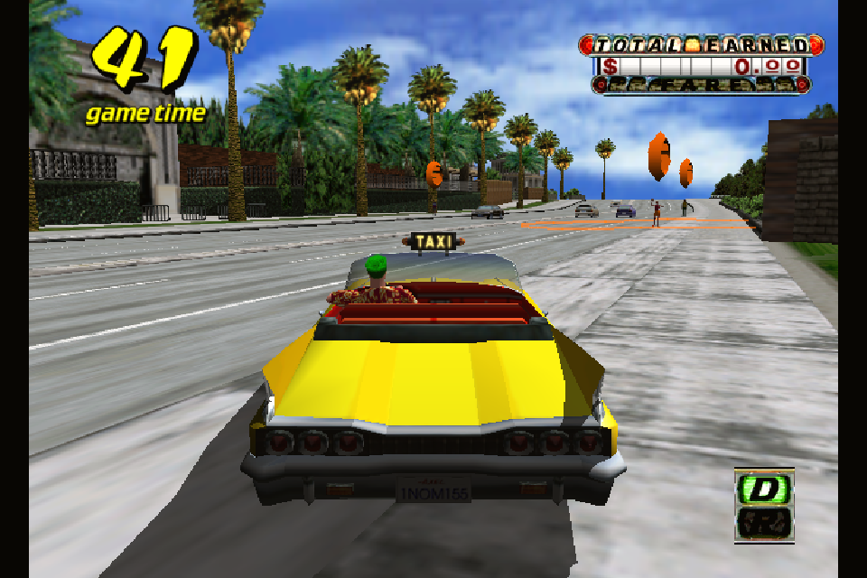](screenshots/dc-raw1x.png) | [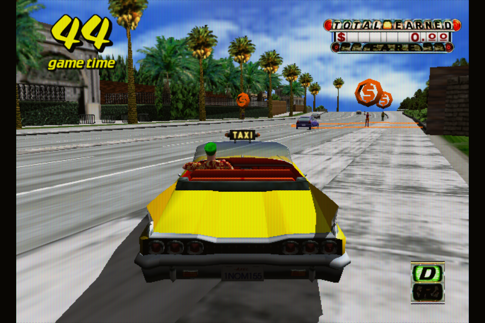](screenshots/dc-custom.png) | [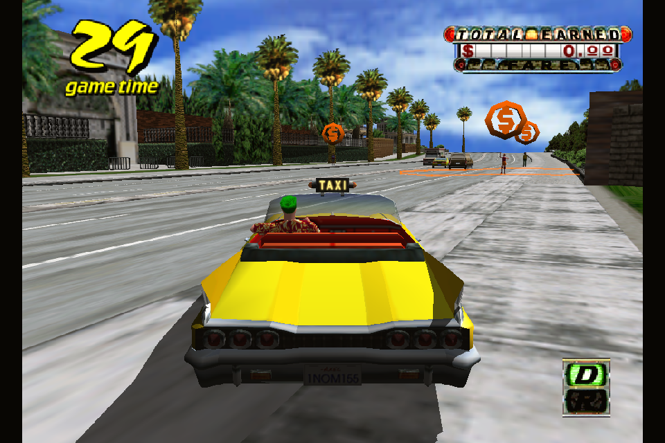](screenshots/dc-raw2x.png) |
| :---: | :---: | :---: |
| Raw 1x | Custom shader with no scanline | Clinical 2x |

<em>Custom <code>crt-noscan.slangp</code></em>

Following the same modular structure, my other presets are:

- The super lightweight `crt-easy.slangp` paired with `crt-easy.params` for tweaking (based on the regular stock `crt-easymode`).

| [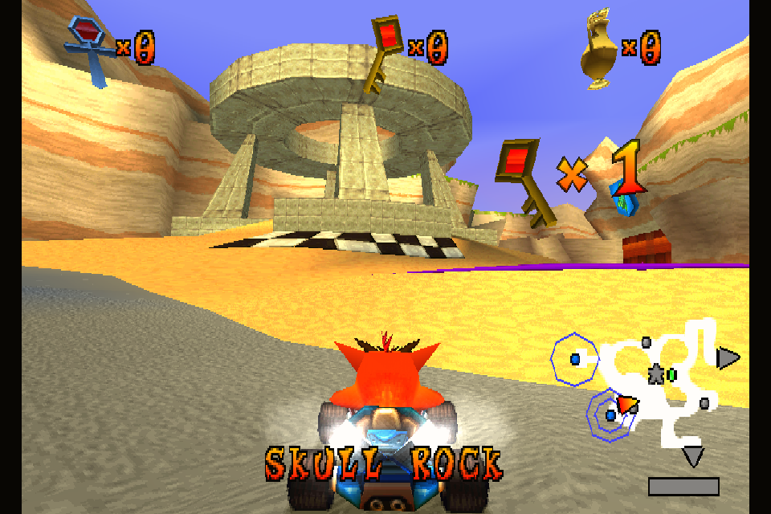](screenshots/ctr-2x.png) | [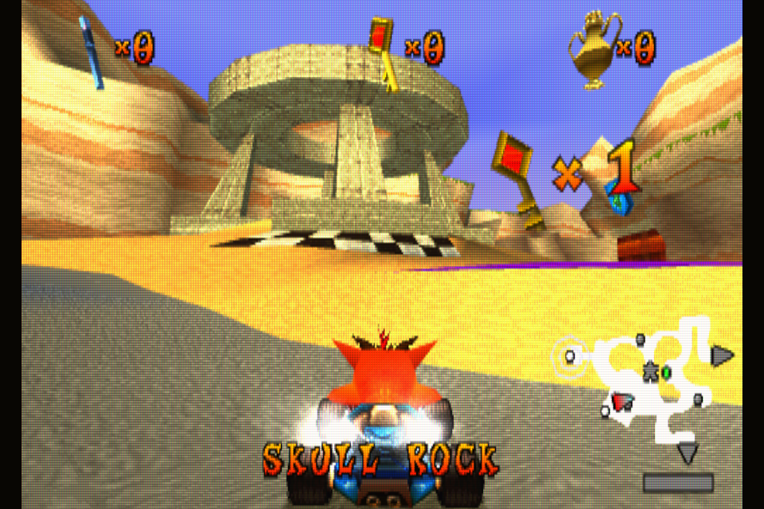](screenshots/ctr-custom.png) |
| :---: | :---: |
| Clinical 2x | With `easymode` |

<em>Custom <code>crt-easy.slangp</code></em>

- The reasonably lightweight `crt-halation.slangp` paired with `crt-halation.params` for tweaking (based on `crt-easymode-halation`).

| [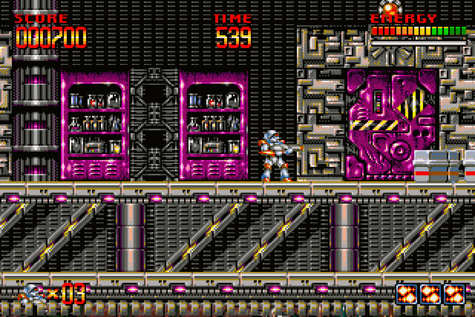](screenshots/turican-raw.png) |  |
| :---: | :---: |
| Raw pixels | With `easymode-halation` |

<em>Custom <code>crt-halation.slangp</code></em>

### LCD Shaders

Some handheld consoles had backlit screens, while others used unlit reflective or front-lit screens. Reflective and front-lit screens rely on a light-colored backing to bounce light back to the viewer, so shaders with bright grid lines make more sense. Conversely, for consoles with backlit screens, dark grid lines are more accurate.

| Console | Original Screen Technology | Emulation Grid / Lighting Style |
| :--- | :--- | :--- |
| **Game Boy (GB / DMG)** | Unlit passive LCD (reflective) | **Light grid** (simulates ambient light / reflective background) |
| **Game Boy Color (GBC)** | Unlit reflective LCD | **Light grid** (simulates ambient light) |
| **Game Boy Advance (GBA Original)** | Unlit reflective LCD (very dim) | **Light grid** (plus gamma/brightness correction) |
| **Game Boy Advance SP (AGS-001)** | Front-lit LCD | **Neutral / Light grid** (front-light simulation) |
| **Game Boy Advance SP (AGS-101)** | Backlit LCD | **Dark grid** (standard backlit display) |
| **WonderSwan (Mono / Color / Crystal)** | Unlit reflective STN/TFT LCD | **Light grid** (reflective background) |
| **Neo Geo Pocket Color (NGPC)** | Unlit reflective STN LCD | **Light grid** (reflective background) |
| **PlayStation Portable (PSP)** | Backlit TFT LCD | **Dark grid** (standard backlit display) |
| **Nintendo DS (Phat / Lite)** | Backlit TFT LCD | **Dark grid** (standard backlit display) |

Hence, I use two shader families:

- `lcd-dark`, `lcd-nds` (`lcd-nds-color` / `lcd-nds-raw`), and `lcd-psp` provide a dark grid. These presets are all based on `lcd1x`, with their parameters factorized into `lcd-dark.params`. I ruled out `lcd-grid-v2` for dark grids because it is too heavy for the KPA, and I was not convinced by the usefulness of `lcd3x`'s RGB subpixel separation on the KPA's small, low-res screen.
- `lcd-light` provides a light grid. This preset is based on `simpletex_lcd` with its parameters stored in `lcd-light.params`. The paper background texture is disabled because it looks coarse on the low-res KPA screen.

| [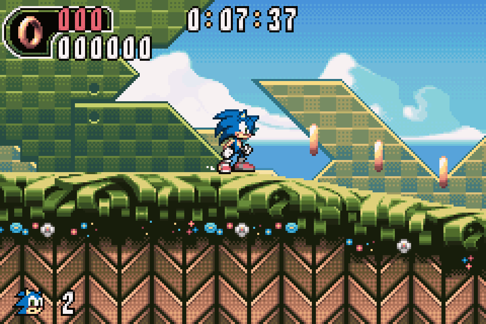](screenshots/gba-raw.png) | [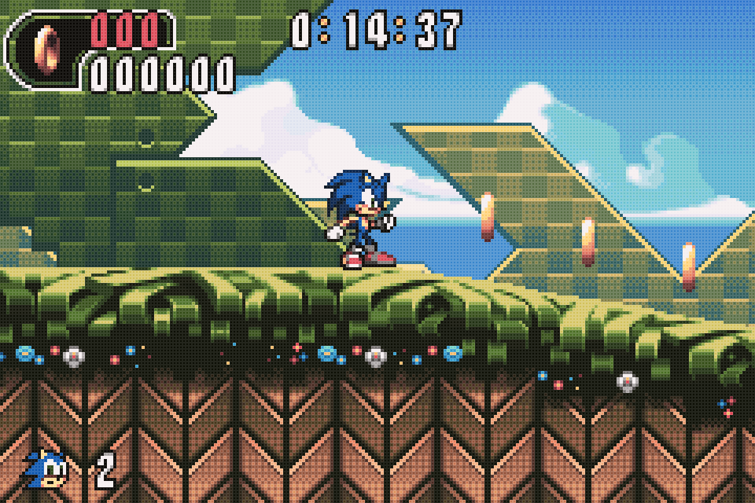](screenshots/gba-light.png) | [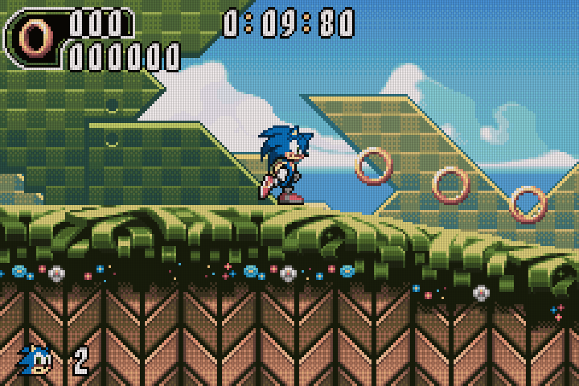](screenshots/gba-dark.png) |
| :---: | :---: | :---: |
| Raw pixels | Dark grid preset | Light grid preset |

<em>Dark and light presets for GBA</em>

Inside `lcd-dark.params` and `lcd-light.params`, parameters are tuned so that the overall luminance and colors roughly match the raw input image, ensuring visual consistency across platforms. For best results, remember to enable color correction in the core options (or use the dedicated color-corrected preset when available).

| [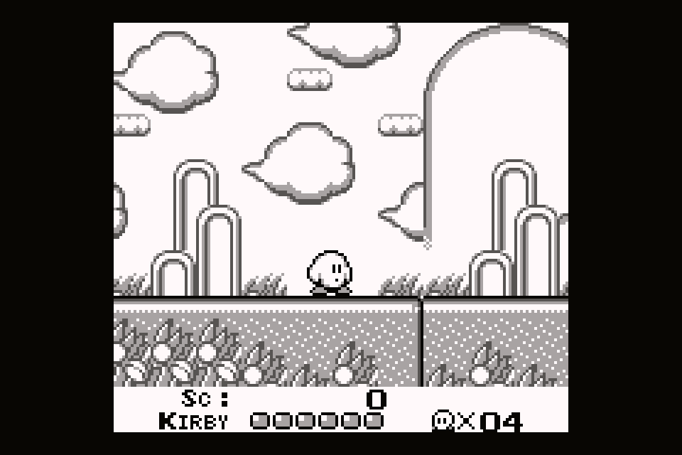](screenshots/gb-raw.png) | [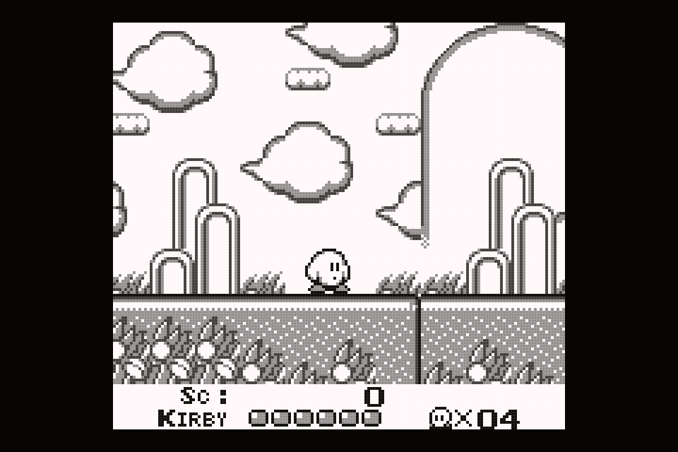](screenshots/gb-light.png) |
| :---: | :---: |
| GB Raw | GB Light |
| [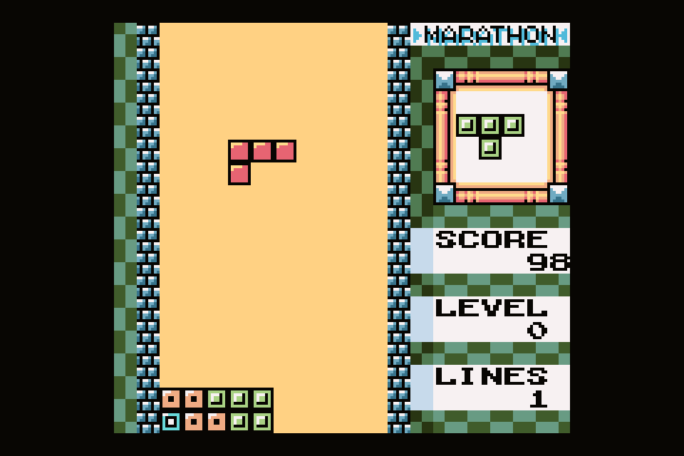](screenshots/gbc-raw.png) | [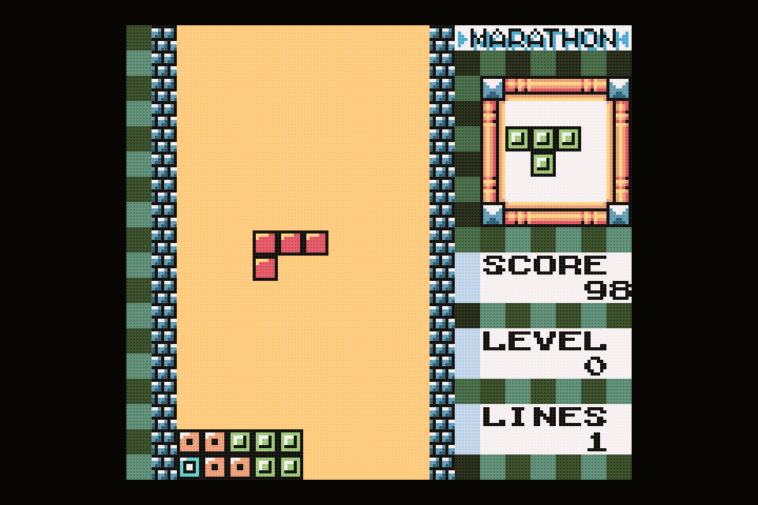](screenshots/gbc-light.png) |
| GBC Raw | GBC Light |

<em>Light preset for GB and GBC</em>

### Nintendo DS

The Nintendo DS is a special case since the `melonDS DS` core cannot natively output a hybrid layout (one large screen and one thumbnail) at an exact integer scale, which ruins balanced LCD grid shaders. To solve this, we prepend a custom layout shader that takes a standard vertical feed (both screens stacked on top of each other), splits them, and rearranges them into a custom side-by-side layout. For the KPA:

- The viewport must be set to `960x576` in RetroArch's video scaling options (and saved as a Core Override).
- The core must be configured with a `Top/Bottom` or `Bottom/Top` screen layout, a screen gap of `0`, and `1x` native resolution (nothing else).

This way, the main screen is 2x integer scaled.

| [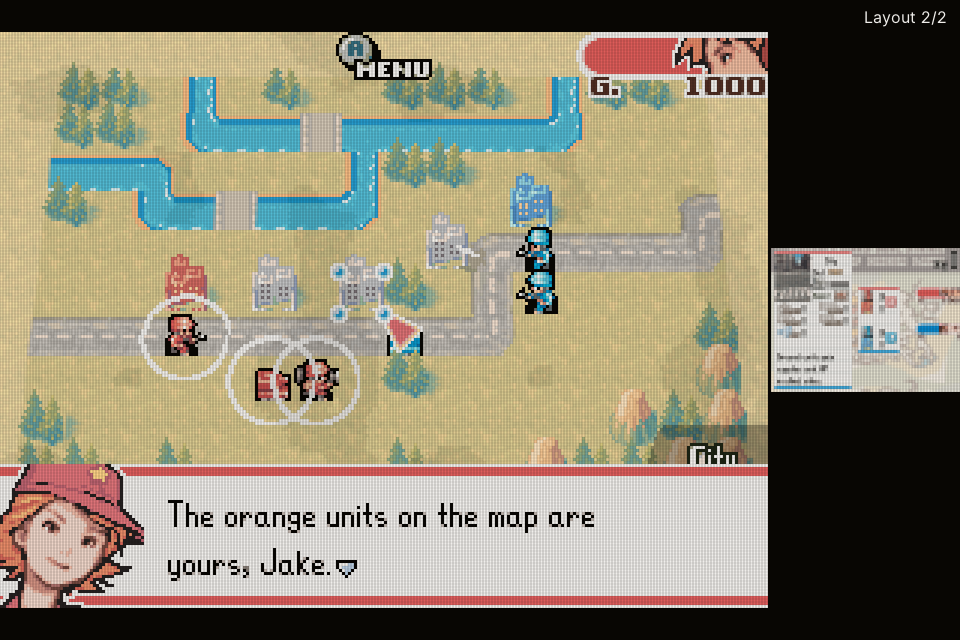](screenshots/nds-tb.png) | [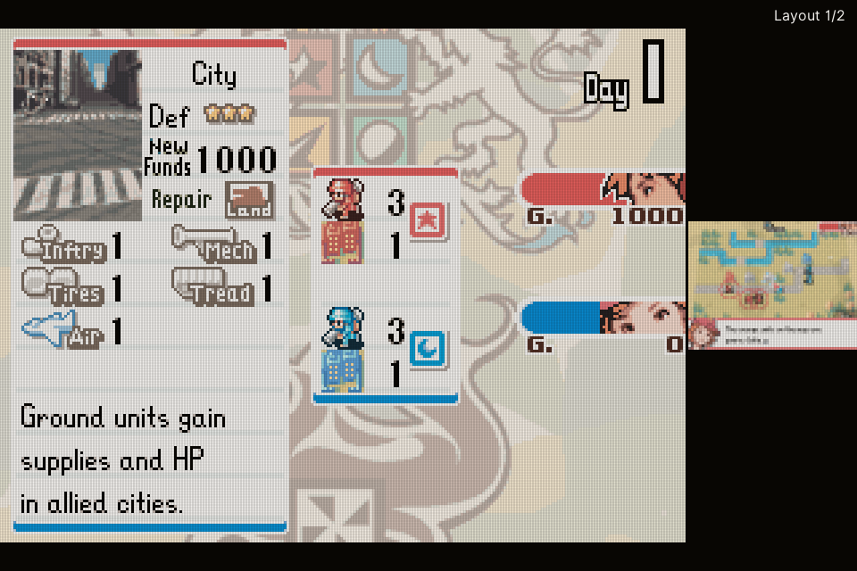](screenshots/nds-bt.png) |
| :---: | :---: |
| Top / Bottom | Bottom / Top |

<em>Both Nintendo DS screen possible layouts</em>

The following files from [the shaders repository](https://github.com/gerpy/kpa-install/tree/main/shaders) must be placed in RetroArch's root `shaders` folder:

- `lcd-dark.params` (holds the grid parameters for `lcd1x-sourcesize.slang`)
- `lcd-nds-color.slangp` and/or `lcd-nds-raw.slangp` (the main presets to load)
- `nds-pipeline-color.slangp` and `nds-pipeline-raw.slangp` (the 3-pass and 2-pass technical pipelines)
- `nds-layout-gap.slang` (splits the screens, scales the main screen to 3x, and creates the 1px gap and 0.25x thumbnail)
- `lcd1x-sourcesize.slang` (modified `lcd1x` shader that reads `SourceSize` instead of `OriginalSize`)

## Shaders for Standalone Emulators

### Dolphin

The built-in shaders don't help much. I had Gemini adapt my multi-pass Slang preset above into a self-contained, single-pass GLSL shader: `crt-dolphin.glsl`.

### ARMSX2

ARMSX2 natively supports RetroArch Slang shaders. It still requires further testing, so for now I'm simply trying to import my `crt-noscan.slangp` preset into ARMSX2. If multi-pass references cause issues, I also had Gemini merge the required passes into a single-pass `crt-armsx2.slangp` preset paired with a standalone `crt-armsx2.slang` shader.

### MelonDS

Standalone melonDS includes a built-in **`LCD`** post-processing shader, but it darkens the image way too much. I stick with the RetroArch `melonDS DS` core and my custom LCD grid shaders instead.
