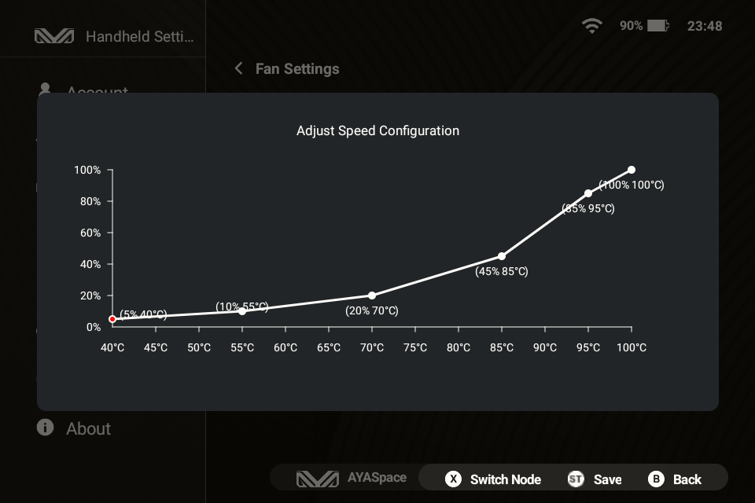

> **Disclaimer: Empirical results below 30% fan speed (with CPU/GPU below 65°C) are so similar that it is difficult to draw any firm conclusions within the 0-30% (or 0-65°C) range. Although I processed the low-temperature data the same way as the higher temperatures (and setup fan speeds as low as 5%), my confidence in the findings drops significantly in this lower bracket. Some users claim there is no real difference between 5% and 30% fan speeds, and my results in this range are not significant enough to state otherwise.**

# KPA Thermals

> These are my own tests conducted on my personal unit, in my own home, at my typical ambient temperature. I am not responsible for any damage to your device—proceed at your own risk. That being said, I took care to push the fan speed to 100.0% before reaching any critical throttling thresholds.

## Test setup

The KPA allows users to define a custom fan curve using six _(temperature, % fan speed)_ coordinates. I conducted empirical tests to find the optimal points and shape the most efficient curve. Each point corresponds to a specific use case—ranging from light to heavy workloads—which translates to different power draws and varying amounts of heat to dissipate.

The more controlled the tests, the better. Fortunately, the KPA allows limiting both CPU and GPU frequencies, effectively capping the maximum power draw for each scenario.

I used the [Burnout Benchmark](https://play.google.com/store/apps/details?id=org.ai.throttling&hl=en) app because it is one of the few tools that allows enabling CPU and GPU stress tests either simultaneously or independently. I tested the following configurations, recording thermal data across 3 or 4 constant fan speeds per scenario:

1. **CPU Off / GPU 420 MHz** (~2.0 W net power draw): Similar to easy 2D games.
2. **CPU Off / GPU 806 MHz** (~3.5 W net power draw): Similar to more demanding 2D games with `halation` shaders (e.g., SF-III FBNeo).
3. **CPU 774 MHz / GPU Off** (~4.8 W net power draw): CPU-heavy 3D emulation with `easy` shaders.
4. **CPU 774 MHz / GPU 420 MHz** (~5.5 W net power draw): High-end 3D emulation with `easy` shaders (e.g., God of War on AetherSX2).
5. **CPU 774 MHz / GPU 806 MHz** (~6.4 W net power draw): Maximum GPU load (e.g., GameNative ?).
6. **Maximum SoC Load** (> 7.0 W): The throttling threshold (around 99.0°C), requiring a 100.0% fan speed as an absolute safety net.

Emulators rarely saturate the SoC completely like a dedicated synthetic torture tool does. Limiting the CPU performance cores and GPU clock speeds mimics realistic, sustained heavy gaming loads. I ran each configuration for 30.0 minutes at various fixed fan speeds, recording the SoC and battery temperatures to find the lowest fan speed that ensures:
a) An asymptotic temperature curve (indicating the SoC is thermally stabilized).
b) Safe internal battery temperatures.

## Test results

> **Note:** My results demonstrate that even when the SoC temperature appears stabilized, heat can accumulate within the chassis beyond a certain power draw. When the shell can no longer dissipate this soak naturally, the battery temperature rises to unsafe levels (I advise keeping it below 45.0°C). Therefore, it is best to run the most demanding games in relatively shorter bursts.

To determine the true thermal capacity for each configuration, I tested several constant fan speeds over 30.0-minute runs (plotted as grey dashed lines below). By calculating the exact warming slope (°C/h) between the 15.0-minute and 30.0-minute marks, I identified the "equilibrium points" (blue stars) where the SoC stops heating up naturally, avoiding unnecessary fan noise while keeping the battery temperature as safe as possible.

Based on these raw stress tests, analyzing the exact thermal slopes leads to the following underlying **equilibrium points**:

| Workload Target | Net Power | Ideal SoC Equilibrium | Internal Battery Temp (Arrival) | Thermal Status & Notes |
| :--- | :---: | :---: | :---: | :--- |
| **CPU Off / GPU 420 MHz** | ~2.0 W | **46.0°C @ 5.0%** *(or 7.0%)* | 33.0°C | Fully stable, silent. |
| **CPU Off / GPU 806 MHz** | ~3.5 W | **66.0°C @ 21.0%** | 36.7°C | Fully stable, very quiet. |
| **CPU 774 MHz / GPU Off** | ~4.8 W | **85.0°C @ 50.0%** | 41.9°C | Stable, safe battery limits. |
| **CPU 774 MHz / GPU 420 MHz** | ~5.5 W | **88.6°C @ 61.0%** | 44.6°C | SoC stabilized, battery nearing 45.0°C limit. |
| **CPU 774 MHz / GPU 806 MHz** | ~6.4 W | **94.0°C @ 77.0%** | 47.8°C | SoC stable, but battery overheats (internal Ohm heating). |
| **Maximum SoC Load** | > 7.0 W | **100.0°C @ 100.0%** | > 48.0°C | Safety shield. |

*(I didn't test a strictly fanless setup at 0.0% since I plan to always keep a gentle baseline airflow).*

## Custom fan curve

The KPA firmware allows defining exactly 6 points at 5.0°C and 5.0% intervals, hard-locked at 40.0°C for the first node and 100.0°C for the last. 

To project our physical equilibrium points onto this strict grid without creating erratic fan behaviors (i.e., avoiding unnecessary bumps and maintaining a perfectly smooth, convex progression), the mathematically optimal coordinates are:

| KPA Node | Temp (°C) | Fan Speed (%) | Progression (Segment Slope) |
| :---: | :---: | :---: | :--- |
| **1** | **40.0°C** | **5.0%** | Baseline |
| **2** | **50.0°C** | **10.0%** | `+0.5 %/°C` (Matches the 46.0°C / 7.0% equilibrium) |
| **3** | **65.0°C** | **20.0%** | `+0.7 %/°C` (Matches the 66.0°C / 21.0% equilibrium) |
| **4** | **85.0°C** | **50.0%** | `+1.5 %/°C` (Matches the 85.0°C / 50.0% equilibrium exactly) |
| **5** | **95.0°C** | **80.0%** | `+3.0 %/°C` (Matches the 88.6°C and 94.0°C equilibriums) |
| **6** | **100.0°C** | **100.0%** | `+4.0 %/°C` (Absolute safety ceiling) |

