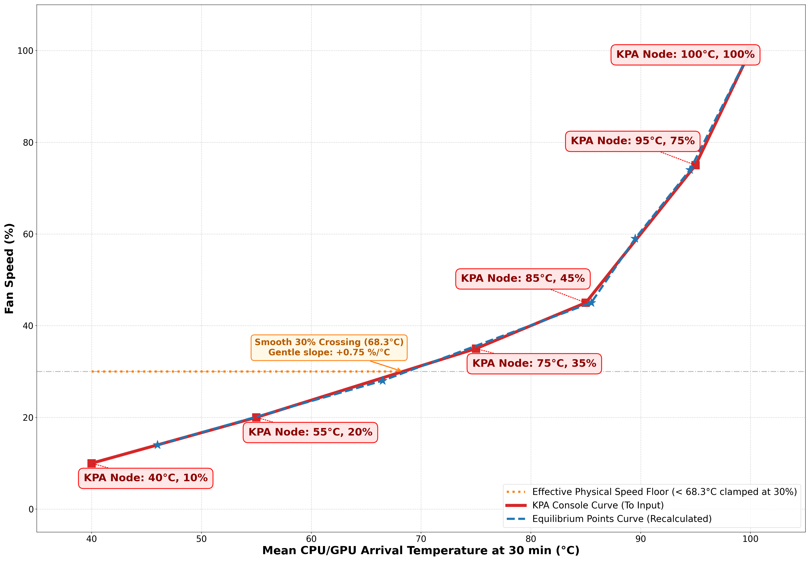

# KPA Thermals

> These are my own tests conducted on my personal unit, in my own home, at my typical ambient temperature. I am not responsible for any damage to your device—proceed at your own risk. That being said, I took care to push the fan speed to 100.0% before reaching any critical throttling thresholds.

## Test setup

The KPA allows users to define a custom fan curve using six _(temperature, % fan speed)_ coordinates. I conducted empirical tests to find the optimal points and shape the most efficient curve. Each point corresponds to a specific use case—ranging from light to heavy workloads—which translates to different power draws and varying amounts of heat to dissipate.

The more controlled the tests, the better. Fortunately, the KPA allows limiting both CPU and GPU frequencies, effectively capping the maximum power draw for each scenario.

I used the [Burnout Benchmark](https://play.google.com/store/apps/details?id=org.ai.throttling&hl=en) app because it is one of the few tools that allows enabling CPU and GPU stress tests either simultaneously or independently. I tested the following configurations, recording thermal data across 3 or 4 constant fan speeds per scenario:

1. **CPU Off / GPU 420 MHz** (~2.0 W net power draw): Similar to easy 2D games.
2. **CPU Off / GPU 806 MHz** (~3.5 W net power draw): Similar to more demanding 2D games with `halation` shaders (e.g., SF-III FBNeo).
3. **CPU 774 MHz / GPU Off** (~4.8 W net power draw): CPU-heavy 3D emulation with `easy` shaders.
4. **CPU 774 MHz / GPU 420 MHz** (~5.5 W net power draw): High-end 3D emulation with `easy` shaders (e.g., God of War on AetherSX2).
5. **CPU 774 MHz / GPU 806 MHz** (~6.4 W net power draw): Maximum GPU load (e.g., GameNative).
6. **Maximum SoC Load** (> 7.0 W): The throttling threshold (around 99.0°C), requiring a 100.0% fan speed as an absolute safety net.

Emulators rarely saturate the SoC completely like a dedicated synthetic torture tool does. Limiting the CPU performance cores and GPU clock speeds mimics realistic, sustained heavy gaming loads. I ran each configuration for 30.0 minutes at various fixed fan speeds, recording the SoC and battery temperatures to find the lowest fan speed that ensures:
a) An asymptotic temperature curve (indicating the SoC is thermally stabilized).
b) Safe internal battery temperatures.

## Test results

> **Note:** My results demonstrate that even when the SoC temperature appears stabilized, heat can accumulate within the chassis beyond a certain power draw. When the shell can no longer dissipate this soak naturally, the battery temperature rises to unsafe levels (I advise keeping it below 45.0°C). Therefore, it is best to run the most demanding games in relatively shorter bursts.

**The 30.0% physical fan floor:** Comparing 30.0-minute runs between 5.0% and 30.0% across multiple workloads reveals identical temperature trajectories, identical noise levels, and an invariant idle current (-0.19 A). As shown below on the ~4.5 W CPU-only workload, the 10.0% and 30.0% target curves superimpose throughout the entire 30.0-minute test (both ending at 88.5°C on the SoC and 40.2°C vs. 39.9°C on the battery). While the overlay displays simulated RPM values proportional to the software target (~507.0 RPM at 10.0% vs. ~1494.3 RPM at 30.0%), the fan physically spins at a constant minimum floor of 30.0% (~1500.0 RPM) for any setting at or below 30.0%, as is typical for small brushless motors that cannot reliably start below 20.0–30.0%.

To determine the true thermal capacity for each configuration, I tested several constant fan speeds over 30.0-minute runs (grey dashed lines below) and calculated the warming slope (°C/h) between 15.0 and 30.0 minutes to isolate the **equilibrium points** (blue stars). Because of the 30.0% hardware floor, all test runs at or below 30.0% in a given workload measure the exact same physical airflow; the first two workloads (~2.0 W and ~3.5 W) are fully stabilized by this 30.0% baseline, and their software equilibrium coordinates (`14.0%` and `28.0%`) are positioned on a virtual ramp to align smoothly with the active regulation points above 30.0%:

| Workload Target | Net Power | Ideal SoC Equilibrium | Internal Battery Temp (Arrival) | Thermal Status & Impact of the 30.0% Floor |
| :--- | :---: | :---: | :---: | :--- |
| **CPU Off / GPU 420 MHz** | ~2.0 W | **46.0°C @ 14.0%** *(30.0% eff.)* | 33.0°C | Fully stable at the 30.0% physical floor (5.0–30.0% runs identical). |
| **CPU Off / GPU 806 MHz** | ~3.5 W | **66.5°C @ 28.0%** *(30.0% eff.)* | 36.8°C | Stabilized by the 30.0% floor (mean of 10.0% and 25.0% runs). |
| **CPU 774 MHz / GPU Off** | ~4.8 W | **85.5°C @ 45.0%** | 42.0°C | Requires exiting the 30.0% floor (which drifts to 88.5–90.5°C). |
| **CPU 774 MHz / GPU 420 MHz** | ~5.5 W | **89.5°C @ 59.0%** | 44.8°C | SoC stabilized, battery kept just under the 45.0°C limit. |
| **CPU 774 MHz / GPU 806 MHz** | ~6.4 W | **94.5°C @ 74.0%** | 47.8°C | SoC stable, but battery overheats (internal Ohm heating). |
| **Maximum SoC Load** | > 7.0 W | **100.0°C @ 100.0%** | > 48.0°C | Safety shield. |

*(I didn't test a 0.0% fanless setting since I plan to always keep the 30.0% baseline airflow active).*

## Custom fan curve

The KPA firmware allows defining 6 points at 5.0°C and 5.0% intervals, locked at 40.0°C and 100.0°C. 

Because any software target below 30.0% clamps the fan to a constant 30.0% physical speed, the first two nodes (`40.0°C @ 10.0%` and `55.0°C @ 20.0%`) are used as a geometric lead-in ramp rather than actual speed changes. This keeps the fan locked at its quiet 30.0% minimum across all 2D workloads up to `68.3°C`, and crosses the 30.0% physical threshold toward `(75.0°C, 35.0%)` at a gentle `+0.8 %/°C` angle, preventing any sudden acoustic jump when active speed modulation begins:

| KPA Node | Temp (°C) | Fan Speed (%) | Progression & Impact of the 30.0% Floor |
| :---: | :---: | :---: | :--- |
| **1** | **40.0°C** | **10.0%** | Baseline (physically clamped at 30.0%). |
| **2** | **55.0°C** | **20.0%** | `+0.7 %/°C` (Virtual ramp passing through 46.0°C / 14.0%; physically clamped at 30.0%). |
| **3** | **75.0°C** | **35.0%** | `+0.8 %/°C` (Passes 66.5°C / 28.0% at 30.0% eff., then smoothly exits the 30.0% floor at 68.3°C). |
| **4** | **85.0°C** | **45.0%** | `+1.0 %/°C` (Active regulation matching the 85.5°C / 45.0% equilibrium). |
| **5** | **95.0°C** | **75.0%** | `+3.0 %/°C` (Turbulent cooling matching the 89.5°C / 59.0% and 94.5°C / 74.0% equilibriums). |
| **6** | **100.0°C** | **100.0%** | `+5.0 %/°C` (Absolute safety ceiling). |

