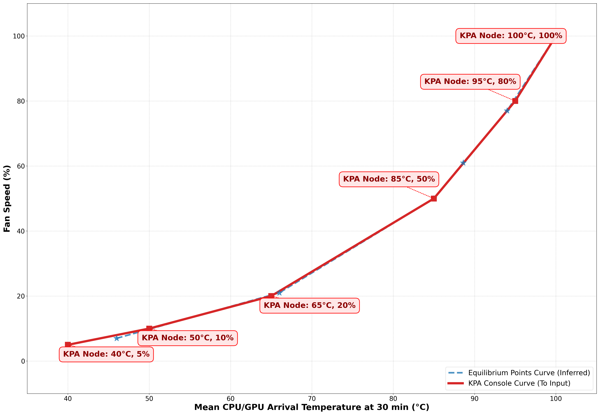

# KPA Thermals

> These are my very own tests on my own unit in my own home at my own ambient temperature, and I am not responsible for any damage to yours—take your own risks. That being said, I took care to set the fan speed to 100% before reaching the throttling threshold.

## Test setup

The KPA allows setting up a custom fan curve with _(temperature, % fan)_ points. I have conducted tests to find adequate points and shape the curve. Each point corresponds to a use case—such as heavy, moderate, or light usage—each leading to a different power draw, a varying amount of heat to dissipate, and an adequate fan speed to keep things under control. The more controlled the tests, the better. Fortunately, the KPA allows limiting CPU and GPU frequencies, thus bounding the power draw.

I'm using the [Burnout Benchmark](https://play.google.com/store/apps/details?id=org.ai.throttling&hl=fr) app for testing because it is the only one that lets you enable both CPU and GPU burn simultaneously, or just one independently. I have tested the following settings, each time with 3 or 4 constant fan speeds:

1. **50% GPU only** (global drawn power roughly similar to easy 2D games with shaders, such as GBA with my grid shader preset).
2. **100% GPU only** (global drawn power roughly similar to more demanding 2D games with shaders, such as SF-III FBNeo with my `halation` shader). 
3. **GPU Off and reduced CPU** performance at 774MHz (global drawn power between the above and below use cases).
4. **50% GPU and reduced CPU** performance at 774MHz (global drawn power roughly similar to high-end PS2/GC games, such as GoW in ARMSX2).
5. **100% GPU and reduced CPU** performance cores at 774MHz (roughly similar to PC games, perhaps).
6. **Throttling point** (about 99°C) requiring maximum security and a 100% fan speed; the purpose of the other points is to avoid getting there while keeping noise levels reasonable.

Emulators don't saturate the GPU and CPU because they cannot run every single core at full speed like a dedicated torture tool such as Burnout Benchmark does. Hence, the limited CPU performance cores and GPU settings are used to mimic actual thermals at Max mode. I have tested several fan speeds for 30 minutes for each use case and recorded temperatures (CPU/GPU and battery) to determine the lowest fan speed that ensures a) an asymptotic shape indicating that the CPU/GPU temperature is under control, and b) that the battery temperature does not spike excessively.

## Test results

> My results show that even when the CPU/GPU temperature is under control, past a certain point, heat accumulates and the shell cannot dissipate it, causing battery temperature to reach unsafe levels (I didn't try to go beyond 45°C, and some curves do not look asymptotic at this point). Therefore, it is best to run the most demanding games for limited periods.

Graphical interpretations for tradeoffs and interpolations lead me to consider these points, based on raw experiments:

1. **46°C SoC $\rightarrow$ 5% fan** for an averaged ~2.00W power draw (excluding fan consumption). Internal battery temperature after 30 min: 33°C (fully stable).
2. **66°C SoC $\rightarrow$ 15% fan** for an averaged ~3.48W power draw (excluding fan consumption). Internal battery temperature after 30 min: ~36°C (fully stable).
3. **85°C SoC $\rightarrow$ 40% fan** for an averaged ~4.76W power draw (excluding fan consumption). Internal battery temperature after 30 min: ~42°C. (roughly stable).
4. **88°C SoC $\rightarrow$ 64% fan** for an averaged ~5.52W power draw (excluding fan consumption). Internal battery temperature after 30 min: ~44°C (not fully stabilized).
5. **93°C SoC $\rightarrow$ 78% fan** for an averaged ~6.35W power draw (excluding fan consumption). Internal battery temperature after 30 min: ~48°C (continues growing).
6. **97°C SoC $\rightarrow$ 95% fan** for an averaged >7.00W power draw (excluding fan consumption). Internal battery temperature after 30 min: ~51°C (out of control)

I didn't test fanless at all since I plan to always keep a gentle airflow.

## Custom fan curve

The KPA permits defining 6 points at resolutions of 5°C and 5%, with the first one at 40°C and the last one at 100°C. The best match I could find with these 6 points—including both ends and allowing for curve smoothing—is:

1. **40°C $\rightarrow$ 5%**
2. **55°C $\rightarrow$ 10%**
3. **70°C $\rightarrow$ 20%**
4. **85°C $\rightarrow$ 45%**
5. **95°C $\rightarrow$ 85%**
6. **100°C $\rightarrow$ 100%**

