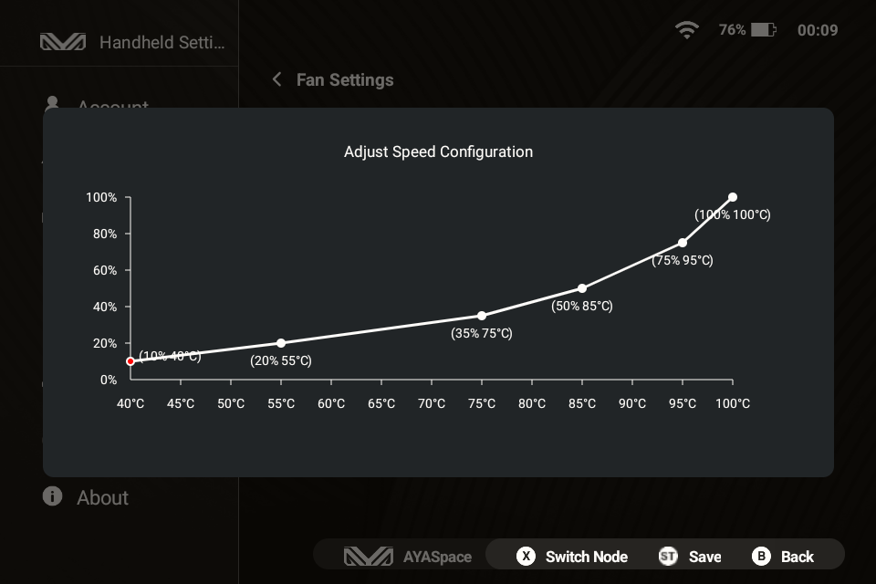

# KPA Thermals

> These are my own tests conducted on my personal unit, in my own home, at my typical ambient temperature. I am not responsible for any damage to your device—proceed at your own risk. That being said, I took care to push the fan speed to 100.0% before reaching any critical throttling thresholds.

## Test setup

The KPA allows users to define a custom fan curve using six _(temperature, % fan speed)_ coordinates. I conducted empirical tests to find the optimal points and shape the most efficient curve. Each point corresponds to a specific use case—ranging from light to heavy workloads—which translates to different power draws and varying amounts of heat to dissipate.

The more controlled the tests, the better. Fortunately, the KPA allows limiting both CPU and GPU frequencies, effectively capping the maximum power draw for each scenario.

I used the [Burnout Benchmark](https://play.google.com/store/apps/details?id=org.ai.throttling&hl=en) app because it is one of the few tools that allows enabling CPU and GPU stress tests either simultaneously or independently. I tested the following configurations, recording thermal data across 3 or 4 constant fan speeds per scenario:

1. **CPU Off / GPU 420 MHz** (~2.0 W net power draw): Similar to easy 2D games.
2. **CPU Off / GPU 806 MHz** (~3.5 W net power draw): Similar to more demanding 2D games with `halation` shaders (e.g., SF-III FBNeo).
3. **CPU 774 MHz / GPU Off** (~4.8 W net power draw): CPU-heavy 3D emulation with `easy` shaders.
4. **CPU 774 MHz / GPU 420 MHz** (~5.5 W net power draw): High-end 3D emulation with `easy` shaders (e.g., God of War on AetherSX2).
5. **CPU 774 MHz / GPU 806 MHz** (~6.4 W net power draw): Maximum GPU load (e.g., GameNative).
6. **Maximum SoC Load** (> 7.0 W): The throttling threshold (around 99.0°C), requiring a 100.0% fan speed as an absolute safety net.

Emulators rarely saturate the SoC completely like a dedicated synthetic torture tool does. Limiting the CPU performance cores and GPU clock speeds mimics realistic, sustained heavy gaming loads. I ran each configuration for 30.0 minutes at various fixed fan speeds, recording the SoC and battery temperatures to find the lowest fan speed that ensures:
a) An asymptotic temperature curve (indicating the SoC is thermally stabilized).
b) Safe internal battery temperatures.

## Test results

> **Note:** My results demonstrate that even when the SoC temperature appears stabilized, heat can accumulate within the chassis beyond a certain power draw. When the shell can no longer dissipate this soak naturally, the battery temperature rises to unsafe levels (I advise keeping it below 45.0°C). Therefore, it is best to run the most demanding games in relatively shorter bursts.

**The 30.0% physical fan floor:** Comparing runs between 5.0% and 30.0% across multiple workloads reveals identical temperature trajectories, identical noise levels, and an invariant idle current (-0.19 A). While the overlay displays simulated RPM values proportional to
